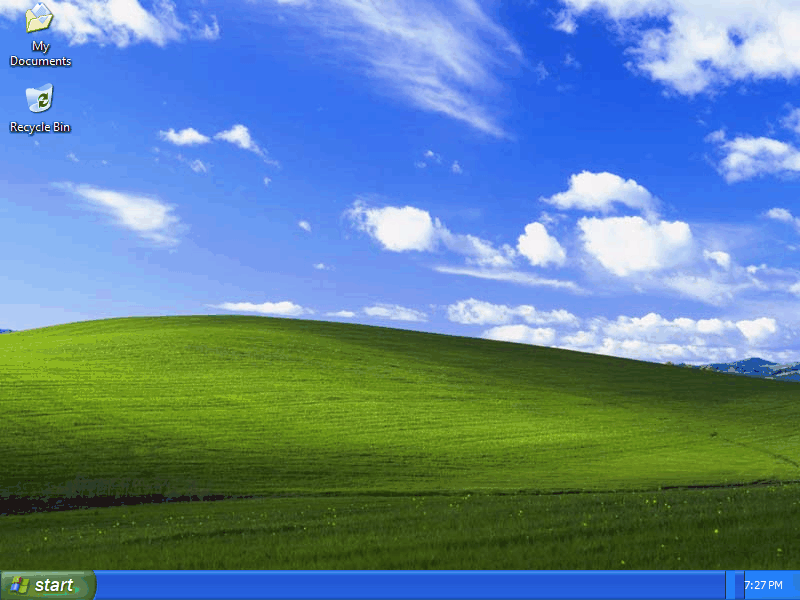
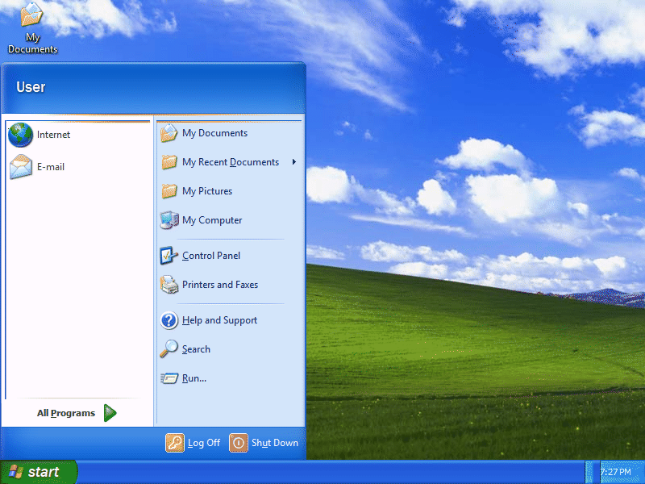
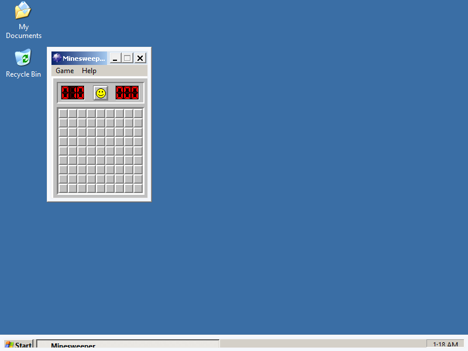
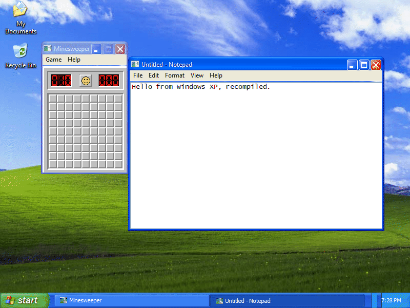
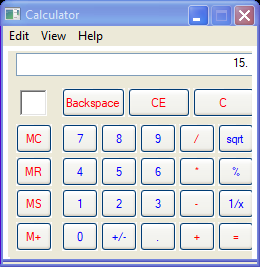
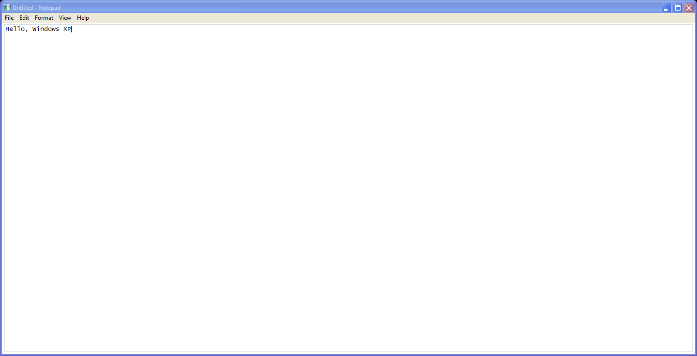
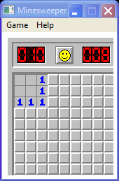
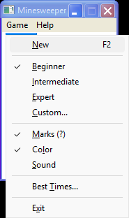

# winxp-recomp

Windows XP's own userland, statically recompiled with
[pcrecomp](https://github.com/sp00nznet/pcrecomp) and run on a modern
Windows host, with no emulator. The sibling of
[win2000-recomp](https://github.com/sp00nznet/win2000-recomp), on the same
runtime: XP-specific answers live in pcrecomp behind a check of the guest's
own build number (`runtime/native32/ntguest.h`), so Windows 2000 keeps
working on the same toolkit.

**This repository contains no Windows code or data.** Each user lifts
their own copy of Windows XP; everything that comes from it (the extracted
files, catalogs, symbols and lifted C) goes into the gitignored `work/` and
`src/gen/`. No product key is needed or read.



| | |
|---|---|
|  |  |
| XP's explorer in Luna on Bliss: its desktop and taskbar (Win11 host, 800x600 screen of its own) | XP's two-pane Start menu: the guest's own user, "User" |
|  |  |
| Run → winmine: explorer starts the lifted winmine in its screen | winmine and notepad started from Run, in themed frames |
|  |  |
| calc on XP's own user32, gdi32 and comctl32 6.0: 12+3= (its window is 10 px short in Luna) | notepad, typed into |
|  |  |
| winmine, a click | the Game menu |

Every shot above is from a run on a private desktop (`tools/hiddenrun.py`),
muted, in its file box. How it works: [docs/survey.md](docs/survey.md) (what
differs from Windows 2000) and win2000-recomp's docs/architecture.md (the
design both share).

## Getting Started

You need **your own Windows XP CD**: an image (`.iso`) of Windows XP with
Service Pack 3 (5.1.2600.5512; made on Media Center Edition 2005 SP3, whose
I386 is Professional SP3's), or the CD itself. Nothing from Windows is in this
repository or downloaded for you; everything is extracted, lifted and built
on your machine from your copy.

1. Download this repository (the green **Code** button, then **Download ZIP**)
   and unzip it, or `git clone` it, into a folder with no spaces in its path
   and about 30 GB free.
2. Double-click **`Setup.cmd`** and give it your CD image when it asks (or
   `Setup.cmd -Iso D:\iso\winxp.iso`; a drive letter or a folder holding
   `I386` works too).
3. Double-click **`Windows XP (recomp).cmd`** in that folder: Windows XP's own
   explorer starts in an 800x600 window of its own, with its desktop, taskbar
   and Start menu.

The setup asks before installing anything it needs (Python 3, pefile and
capstone, Git for Windows, 7-Zip, Visual Studio's C++ Build Tools, CMake,
Ninja, and the [pcrecomp](https://github.com/sp00nznet/pcrecomp) toolkit
beside this folder, or wherever `PCRECOMP` points; XP needs its `luna` branch).
The first run takes about 50 minutes and 7.2 GB (a clean clone, 2026-11-18); a rerun skips every finished step
(`-Force` redoes them, `-Yes` answers yes to every question). Its log is
`setup.log`. The guest sees only `work\profile` as its drives, has a registry
box of its own (`HKCU\Software\pcrecomp\xp`) and makes no sound.

## Status

Source used: Windows XP Media Center Edition 2005 SP3 CD (NT 5.1.2600.5512).

| Stage | What | State |
|---|---|---|
| 1 | Stock accessories lifted on native32 against the host's DLLs | winmine, notepad, calc run |
| 2 | XP's own ntdll + kernel32 + msvcrt (+ user32/gdi32 mapped) lifted, started by ntdll's LdrInitializeThunk; system calls through XP's `call [7FFE0300h]` stubs | `cmd /c ver` prints `Microsoft Windows XP [Version 5.1.2600]`; echo, dir (of the file box), set, if, for |
| 3 | XP's own user32/gdi32, shell32, comctl32 5.82 and **6.0** (side by side, from the CD's SxS store), uxtheme, imm32, ... lifted, on pcrecomp's win32k layer with XP's layouts | `tools/interact.py`: winmine (start, click, Intermediate, Custom 20x30, menus) and notepad (start, typed) pixel-identical to stage 1; calc runs and computes on comctl32 6.0 |
| explorer | explorer.exe and 40 of XP's DLLs, built as one DLL per module (`--target ntexplorer_parts`) | desktop, taskbar and the XP Start menu; the strict host-module check passes (only advapi32 proxied) |

The guest never sees the host's identity: it is user `User` on computer
`PCRECOMP`, at the local console (pcrecomp regbox32.c, syscall32.c).

**Luna and Bliss.** XP's own look: the lifted uxtheme loads the CD's
`luna.msstyles` as data (its ThemeApiPort answered by pcrecomp, its user32
hooks installed as win32k would), and draws the green Start button, the blue
taskbar, the two-pane Start menu and themed window frames (caption, buttons,
rounded corners) through XP's DrawStream. The wallpaper is the CD's Bliss.
Both are expanded from your CD into `work/profile` by `tools/run_explorer.sh`
and set only in the guest's boxed registry (`tools/profile.py`): the host's
theme and wallpaper are never touched.

Known gaps: the Run dialog's frame is still classic and its icon blank;
popup menus (the Start menu's submenus, an app's menus) are drawn by the
host, not themed; the Start menu has no user picture and no most-used
programs list; after a resize (winmine's Intermediate, Custom) a strip of the
old frame is left unpainted; calc's window comes out 10 px narrower than its
buttons in Luna, clipping its right column (Run is reached by explorer's own
command, `--childpost 'Shell_TrayWnd:0x111,0x191,0@T'`). calc's buttons take
its own red/blue label colours (stage 1 on Windows 11's comctl32 draws them
black).

Regression: `py -3 tools/interact.py` drives the accessories (in Luna;
`XP_LUNA=0` for the classic look) and compares each shot with the stage 1
build's (informational in Luna: stage 1 has the host's look) and with the
approved golden for this display. Goldens for 3840x2160@192: winmine start,
click and Game menu, notepad start and typed; the states with the gaps above
have none and fail as "NO GOLDEN". `tools/run_explorer.sh NAME SECS` runs explorer and fails
when any host module other than advapi32 is mapped into the guest.

## Building by hand

`Setup.cmd` does all of this; `tools/setup.ps1` is the whole order, command
for command.

Prerequisites: Visual Studio 2022 (C++ x86 tools), CMake, Ninja, Python 3
with `capstone` and `pefile`, 7-Zip, Git for Windows (its bash runs
`tools/*.sh`), and a pcrecomp checkout with the XP support at `../pcrecomp`
(or `PCRECOMP=...`).

```
7z x -owork\iso <your XP CD image> "I386/*"
sh tools/fetch_xp.sh                  # work\sys and work\rebased-shell: every module at its base
py -3 tools\w32k_names.py "Windows XP" SP3 > work\names\win32k.txt   # (work\names\win32k-per-system.json from github.com/j00ru/windows-syscalls)
sh tools/lift_accessories.sh          # winmine, notepad, calc (or: cmd)
sh tools/lift_explorer.sh             # explorer, its part DLLs, XP's COM classes into the box
sh tools/run_explorer.sh first 30     # hidden, muted, boxed; shots/exp/first_27.png
```

Run everything muted, on a private desktop, in the file box:

```
set PCRECOMP_MUTE=1
set HIDDENRUN_DESKTOP=pcrecomp_xp
set PCRECOMP_FILEBOX=%CD%\work\profile
py -3 tools\hiddenrun.py --secs 15 --out shots\ver -- build\cmd.exe --mute --watchdog 12 -- /c ver
```

The host refuses to start any program that is not lifted (`[guard]` on
stderr): no original Windows XP binary is ever run natively.
`NATIVE32_SYSCALLS=1` traces every system call, `PCRECOMP_REGTRACE=1` (`=2`:
every open) the registry box, `PCRECOMP_FAULTTRACE=1` the guest stack at a
host fault. `tools/pdbsyms.py` names a module's addresses from Microsoft's
public symbols (kept in `work/pdb`), `tools/faultline.sh` shows the lifted C
at a host fault address. A run that faults names the function it could not
find (`ICALL: unresolved`): `sh tools/seed.sh shots\ver.log` records it for the
next lift.

## License

MIT (LICENSE; this repository's scripts and host code only). Windows XP is
Microsoft's; bring your own copy.
